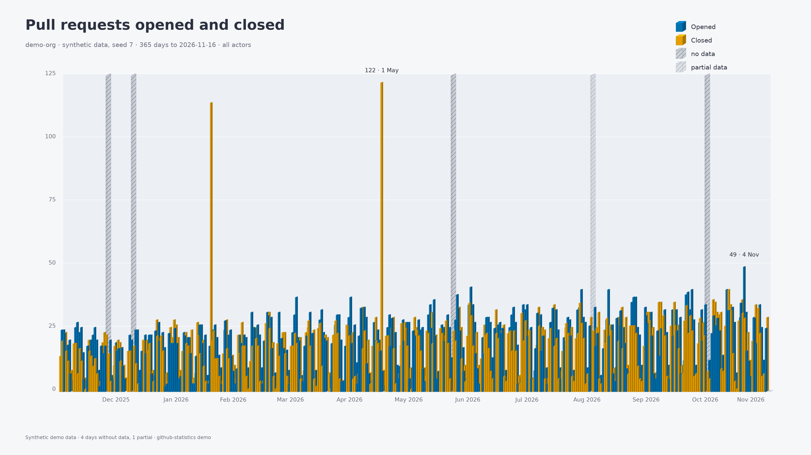
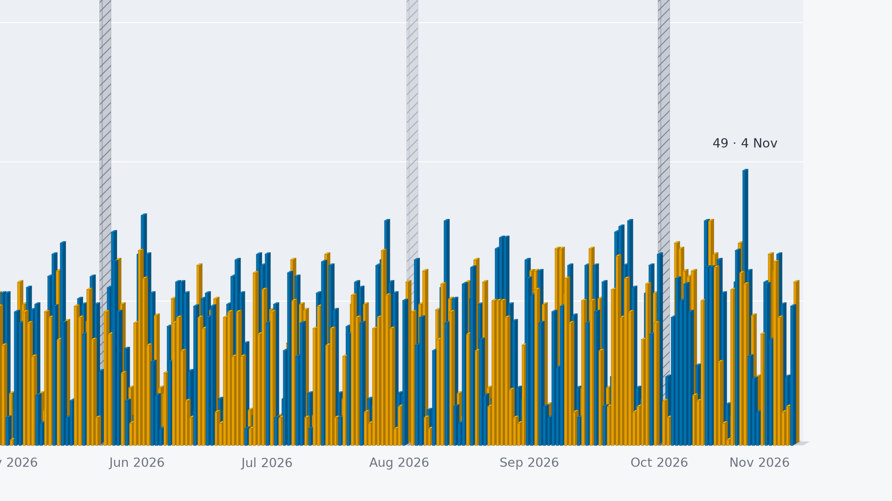
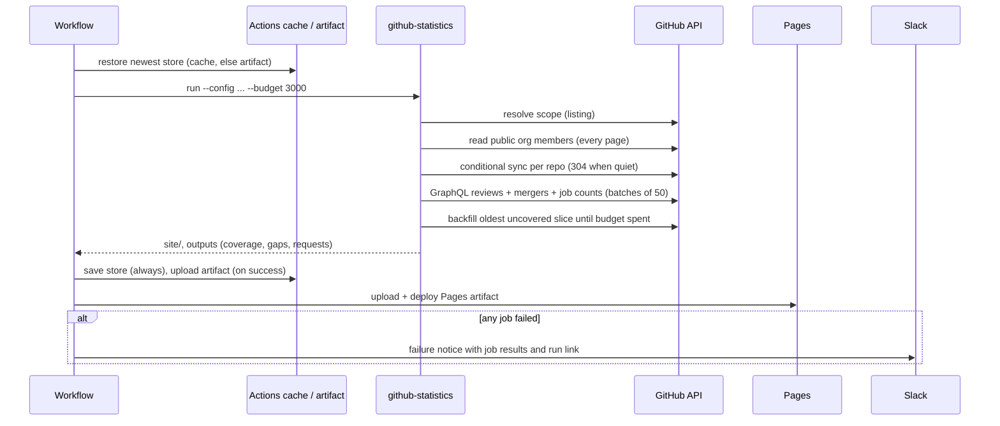

<!--
SPDX-License-Identifier: Apache-2.0
SPDX-FileCopyrightText: 2026 The Linux Foundation
-->

# GitHub Statistics: design and architecture

| Field   | Value                                                  |
| ------- | ------------------------------------------------------ |
| Status  | Accepted; open questions settled (§14)                 |
| Date    | 2026-10-29, revised 2026-11-16                         |
| Scope   | `github-statistics-action` (tool, action and site)     |
| Informs | Phase plan in §13; ADRs under `docs/adr/` once decided |

## 1. Purpose

Publish a daily, visual picture of activity in a GitHub organisation, a
subset of its repositories, or a single repository: pull requests, issues
and CI, each as a 3D bar chart with one bar per day across a configurable
window (default 365 days), with contributor leaderboards beneath. The
output is a GitHub Pages site, generated by a Python CLI published to PyPI
and wrapped in a thin composite action, in the manner of
`github-security-report-action` (GSR) and `project-reporting-tool` (PRT).

Goals, in priority order:

1. **Scope variance.** One repository, a list, or a whole organisation,
   with identical output, through one code path.
2. **Portable to other organisations.** No organisation-specific value
   lives in the code; anything that varies per organisation (bot
   identities and membership above all) comes from configuration, and
   every such setting is available at every level a consumer works at:
   CLI, configuration file, workflow input, repository or organisation
   variable (§7.2).
3. **Daily resolution over a long window**, rendered at a native 4K
   resolution that still reads when downscaled into a web page.
4. **No data repository.** State persists between daily runs without
   committing blobs to git.
5. **Self-healing.** A failed day costs nothing but a delay; gaps in the
   data show as gaps, never as zeros; failures reach Slack.

Non-goals for the first release: Gerrit or Jenkins sources, per-user
pages, commit metrics, review charts (the tool collects reviews and shows
in the leaderboards from the start, §6.3 and §7.4, but get no chart of
their own until phase 6), and interactive (WebGL) charts. §8.1 and §13
name some of these as later work.

## 2. Audit of the repositories in context

I read the repositories in the workspace for reusable patterns and for
problems the new tool should avoid. The findings sit per repository:
"Adopt" items shape this design; "Improve" items are suggestions for
the repositories themselves and are out of scope here unless stated.

### 2.1 `github-statistics-action`

State: an untouched copy of `actions-template`. It carries
the canonical linting set (`prek` hooks: gitlint, ruff, mypy,
basedpyright, markdownlint, write-good, reuse, actionlint, zizmor-adjacent
`gha-workflow-linter`, codespell, aislop), plus Go and ESLint hooks
that `.github/hooks/manifest-guard.sh` keeps inert until a `go.mod` or
`package.json` appears.

Adopt: the hook set as the template ships it, `.gitlint`, the
`testing.yaml` shape with `harden-runner-block-action` and the org
allow-list, `release-drafter.yaml`, and the template's local-action
reference convention (`uses: $/`). The template's `release.yaml` goes:
it fires on the same tag pushes as the Python package's
`build-test-release.yaml` (§4.1) and would race it to promote the draft
release. The Go and ESLint hooks and their configuration stay: they
cost nothing while no manifest exists, the template tests their guard,
and removing them would make this repository drift from the canonical
template.

Improve, across the first pull requests:

- Replace the placeholder `README.md` now, and `action.yaml` and
  `testing.yaml` in phase 5 once the action has something to run (they
  still describe and badge `actions-template`).
- Add a `pyproject.toml` with `hatch-vcs` versioning as in GSR
  (phase 2).
- Extend `dependabot.yml` with the `uv` ecosystem and the `pip` ecosystem
  for `.github/runtime-pin/` (§9.1), both with a seven-day cooldown as GSR
  configures (phase 2).

### 2.2 `project-reporting-tool`

A 33k-line multi-source reporting system. Its Pages site, multi-project
landing page, and sortable tables are the precedent the user cited.

Adopt: the multi-target site layout (landing page, one page per target),
Jinja2 templates packaged with the tool, the sortable and searchable
tables, and the Slack failure job.

Improve (raised as `project-reporting-tool` issues #337 to #343 and
resolved through #380; listed here for the reasoning they gave this
design):

- **Unpinned CDN script without integrity.** `datatables_support.html.j2`
  loads `simple-datatables@latest` from jsDelivr with no SRI hash. Every
  page view executes whatever the latest published version is. GSR pins
  the version and ships SRI hashes (`render/html.py`); back-port that.
- **Top-level package names.** The wheel installs `api`, `cli`, `config`,
  `domain`, `util`, `templates`, `themes`, `rendering`, `performance`,
  `observability` and `concurrency` as top-level importable packages
  (`[tool.hatch.build.targets.wheel] packages`). Installed into any shared
  environment these collide with other distributions. Everything should
  live under `lf_releng_project_reporting`.
- **Publishing by branch push.** `reporting-production.yaml` (1,492
  lines) commits the site to a `gh-pages` branch and copies raw data into
  a second repository. GSR's `upload-pages-artifact`/`deploy-pages` pair
  needs no branch, no push token and no history.
- **Documentation sprawl.** `docs/` holds 68 files, around twenty of
  them status reports (`*_COMPLETE.md`, `*_FIX_REPORT.md`, `PHASE8_*`). The org
  guidelines ask for documentation edited in place, with git history as
  the changelog. The wheel also ships the whole `docs/` tree as shared
  data.
- Two configuration directories (`config/` and `configuration/`) carry
  overlapping `default.yaml` and `organizational_domains.yaml` files.
- `README.md` opens with `pip install .`; the org standard is `uv`.

### 2.3 `project-reporting-artifacts`

`data/` held 19,221 files, 55 GB on disk, with a 4 GB `.git`, and grew
by one dated folder per day. The constraint for the new tool (no data
repository) follows from this. The repository stopped receiving data in
October 2026, PRT's raw outputs now live as 90-day workflow artifacts,
and the organisation deleted the repository after an offline backup. PRT's own
`gh-pages` branch, which had grown the same way, was reset and then
replaced by `deploy-pages`; the design adopts that model from the start.

### 2.4 `github-security-report-action`

The closest relative: a Typer CLI on PyPI, a composite action, a daily
workflow publishing Pages and posting to Slack, JSON configuration under
`~/.config`, and a SQLite cache persisted through the Actions cache. Its
ADR-0007 also contains measured facts about `lfreleng-actions` that size
this design (§6.6).

Adopt wholesale (as patterns, and where the licence and shape allow, as
code lifted into the new package):

- `config/loader.py`: JSON or base64-JSON from a variable or secret,
  `$XDG_CONFIG_HOME/<tool>/config.json` fallback, `jsonschema` validation,
  `token_env` indirection per organisation.
- `workflow_runs/store.py`: stdlib `sqlite3`, explicit transactions,
  `user_version` schema stamp that drops and recreates on mismatch,
  sanitised `<api-host>/<org>/` path components.
- `client/transport.py`: `httpx` with a shared retry/backoff budget,
  `Retry-After` handling, 401 fail-fast, request accounting.
- `collect/run_sync.py`: watermark plus ETag incremental sync, date
  slicing under the 1,000-item listing cap, pending re-reads.
- The GraphQL `nodes(ids:)` drill-down over `WorkflowRun` that reads
  `checkSuite.checkRuns.totalCount` for fifty runs per one-point query.
  That is the job count this tool needs (§6.4).
- `action.yaml`: `uvx --from <pin> <tool>`, the Dependabot-managed
  runtime pin, hybrid local-source mode on pull requests, the token
  environment-variable indirection and its validation.
- `reporting.yaml`: encrypted cache restore and save, Pages deploy, the
  `notify-failure` job and the Slack credential check.

Improve: three repositories now carry a GitHub transport and store of
their own (GSR, PRT, and this one). After this tool ships, extracting
`transport`, `paging`, the GraphQL batch driver and the store base into
a small shared package would remove the third copy. Not in scope here.

### 2.5 `.github` (organisation)

Adopt: the Slack convention (`secrets.SLACK_BOT_TOKEN`,
`vars.SLACK_CHANNEL_ID`, `environment: 'production'`,
`slackapi/slack-github-action` with `chat.postMessage`), the GitHub App
identity (`vars.LF_RELENG_BOT_CLIENT_ID`,
`secrets.LF_RELENG_BOT_PRIVATE_KEY`, `actions/create-github-app-token`
scoped to an owner), and the scope vocabulary of `scan-scope.json`
(`scan_archived`, `scan_forks`, `scan_templates`,
`include`, `exclude`). The tool's scope block uses the same words so an
operator who knows one knows the other; it has no `scan_private`, since
private repositories are out of scope (§5).

Improve: `repo-discovery.yaml` applies the scope policy in shell for
workflow callers alone. A tool meant for other organisations has to carry
its own resolver (§5), so the policy ends up implemented twice. Letting
the tool read a `scan-scope.json` file or URL as a scope source (a
`scope_from` key) would keep one policy for both.

### 2.6 `list-splitter-action`

Useful at a single point: normalising a `workflow_dispatch`
`repositories` input (comma, space or newline separated), validating each
item as a repository name and, with `verify: true`, confirming it exists
before the tool runs. Its `csv` output feeds the action's `repositories`
input. A matrix fan-out across repositories (its other common use) is
not used here: the collectors share one rate limit and one
store, so parallel jobs would gain nothing and would need a merge step.

## 3. Requirements

Functional:

| ID  | Statement                                                       |
| --- | --------------------------------------------------------------- |
| F1  | Metrics: PRs opened/closed, issues opened/closed, workflow runs |
|     | and jobs, each as a daily count over the window                 |
| F2  | Default window 365 days ending yesterday (UTC); configurable    |
| F3  | Scope: whole organisation (default), user account, include or   |
|     | exclude list (mutually exclusive), or explicit `owner/name`s    |
| F4  | Configuration as JSON: file under `~/.config`, or a repository  |
|     | or organisation variable (raw or base64), or a CLI path         |
| F5  | Four actor classes: publicly listed organisation members,       |
|     | external contributors (every other human), the organisation's   |
|     | own bots, external bots; bot lists explicit, no defaults        |
| F6  | Sub-charts per actor class, plus "all"; every identity setting  |
|     | settable by CLI, config file, workflow input and repository or  |
|     | organisation variable                                           |
| F7  | Two rows per chart; the larger value of the day at the back so  |
|     | the smaller stays visible; fixed colour per series              |
| F8  | Gap days (no or partial data) rendered distinctly from zero     |
| F9  | Contributor leaderboard credited to authors (PRs opened, merged |
|     | and closed unmerged; issues opened and closed), with reviewer   |
|     | columns; sortable and searchable in the browser                 |
| F10 | Output to a configurable directory; a landing page per target   |
| F11 | Data persists between daily runs without a git data repository  |
| F12 | Failures of collection, rendering or deployment post to Slack   |
| F13 | Daily workflow runs the PyPI release via `uvx` under a pin that |
|     | advances through reviewed pull requests                         |
| F14 | Pull-request reviews ingested (reviewer, state, time) and kept  |
|     | in the store and the data export                                |
| F15 | Public data alone: the tool never reads, stores or publishes a  |
|     | private repository or a private organisation membership         |

Non-functional:

| ID  | Statement                                                       |
| --- | --------------------------------------------------------------- |
| N1  | Native chart resolution 3840×2160 (4K UHD); a 1920-wide         |
|     | derivative for inline embedding                                 |
| N2  | A warm daily run for a 150-repository organisation completes in |
|     | under 15 minutes and under 1,500 REST requests                  |
| N3  | A cold start completes over more than one run under a per-run   |
|     | request budget; it never fails for lack of budget               |
| N4  | Pure-Python dependencies with wheels on Linux, macOS, Windows;  |
|     | no display server, GPU or browser needed to render              |
| N5  | Deterministic output for a given store and configuration        |
| N6  | Org linting and security gates (prek, zizmor auditor persona,   |
|     | aislop) pass on every change                                    |

## 4. Architecture overview

```mermaid
flowchart TD
    CFG[Config JSON<br/>file / variable / CLI] --> SCOPE[Scope resolver]
    SCOPE --> COLLECT[Collectors<br/>issues+PRs, reviews, runs, jobs, members]
    COLLECT <--> GH[(GitHub REST<br/>and GraphQL)]
    COLLECT --> STORE[(SQLite store<br/>events, sync_state, coverage)]
    STORE --> SERIES[Series builder<br/>daily series, leaderboards, coverage]
    SERIES --> RENDER[Chart renderer<br/>matplotlib 2.5D]
    RENDER --> OUT[Output directory]
    SERIES --> SITE[Site generator<br/>Jinja2]
    SITE --> OUT
    SERIES --> EXPORT[JSON / CSV export]
    EXPORT --> OUT
    CFG --> SERIES
    PAGES[GitHub Pages] <-- deploy --- OUT
    STORE <--> CACHE[Actions cache<br/>+ artifact fallback]
```

Three strict layers, as in GSR: **collect** talks to GitHub and writes
the store; **series** reads the store and produces plain data
structures; **render** turns those into images, HTML and JSON. Nothing in
render or series touches the network, so re-rendering after a
configuration change (a new bot name, a new palette) costs no requests.

### 4.1 Package layout

```text
src/github_statistics/
  cli/            Typer app: scope, collect, render, site, run, export,
                  doctor, config, cache
  config/         schema.py (jsonschema), models.py (frozen dataclasses),
                  loader.py (file, variable, XDG default)
  client/         transport.py, policy.py, accounting.py, cooldown.py,
                  paging.py, budget.py, errors.py, graphql.py (batched
                  nodes()), runs.py, closers.py
  scope/          resolver.py: targets -> concrete repository list;
                  apply.py: the resolved list -> the store's scope table
  store/          models.py (records), codec.py (rows), schema.py,
                  base.py (transactions), sqlite.py (Store), paths.py
  collect/        items.py (issues and pull requests), sync per
                  metric, coverage.py
  series/         daily.py, identity.py, leaderboard.py, coverage.py
  render/         model.py (ChartSpec, Style), layout.py (plan_chart),
                  bars3d.py (chart), palette.py, images.py
                  (derivatives), demo.py (synthetic data)
  site/           templates/ (Jinja2), assets/ (CSS), build.py
  export/         json.py, csv.py
```

The client reads and never writes, by construction (§9.4):
`client/transport.py` sends a REST `GET`, and a GraphQL query as a
`POST` to the GraphQL endpoint, and nothing else. It refuses any other
method, and a GraphQL document that defines a mutation or a
subscription, before sending. Resending any request is safe, so one
retry rule covers transport failures, rate limits and `5xx` alike, and
a `GET` alone follows a redirect. The token goes to the API host alone,
and over HTTPS alone unless the caller opts out.

Distribution name `github-statistics` (free on PyPI as of the date
above; someone already holds `github-stats`), import package
`github_statistics`,
console script `github-statistics`. Versioning from git tags via
`hatch-vcs`, exact-pinned runtime dependencies as GSR does, published
through `lfreleng-actions/pypi-publish-action` with the test-PyPI then
PyPI environment pair from GSR's `build-test-release.yaml`.

Runtime dependencies: `httpx[http2]`, `typer`, `rich`, `jinja2`,
`jsonschema`, `matplotlib`, `numpy`, `pillow`. The last three are the
additions over GSR's set; §8.1 justifies them.

### 4.2 Command line

```text
github-statistics run      collect + render + site + export (the action)
github-statistics scope    print the resolved public repositories
github-statistics collect  sync the store for the resolved scope
github-statistics render   charts from the store, no network
github-statistics site     HTML from the store and charts, no network
github-statistics export   daily series and leaderboards as JSON/CSV
github-statistics doctor   token, rate limit, scope, unclassified bots,
                           store health
github-statistics demo     sample charts from synthetic data, no token
github-statistics config   show | check | path
github-statistics cache    info | clear [--owner]
```

Shared options (config first, then CLI overrides, as in GSR):

```text
--config PATH | --config-data JSON|BASE64
--org OWNER            (repeatable; default: every configured target)
--repo OWNER/NAME      (repeatable; repository scope, no org listing)
--include a,b,c        \ mutually exclusive; names or globs, applied to
--exclude a,b,c        / the organisation listing
--days N               window length (default 365)
--until YYYY-MM-DD     window end (default: yesterday, UTC)
--output-dir DIR       site root (default ./site)
--cache-dir DIR        store root (default $XDG_CACHE_HOME/github-statistics)
--budget N             REST requests this run may spend (default 3000)
--token-env NAME       environment variable holding the token
--refresh              ignore watermarks; re-read the window
--strict               exit non-zero on any unreadable repository

Identity options (each replaces the configured list for that key;
comma-, space- or newline-separated, repeatable; §7.2):
--org-bots LOGINS      the organisation's own bots
--external-bots LOGINS bots from outside the organisation
--members LOGINS       humans to treat as members (publishes them, §7.1)
--member-orgs OWNERS   organisations whose public members count as
                       members (default: the target owner)
--ignore-logins LOGINS accounts left out of every output
```

Typer callbacks enforce the exclusivity rules (`--include` with
`--exclude`; `--repo` with either) at parse time with a one-line error,
and the loader's `resolve` rejects the same combinations for any caller.
`--repo` names exact repositories: a name holding anything GitHub does
not allow in one, a glob character included, fails.

## 5. Scope resolution

The single most important abstraction. A **target** is one owner plus a
selection rule; a run handles one or more targets and renders one page
per target plus a landing page.

```json
{
  "targets": [
    {
      "owner": "lfreleng-actions",
      "token_env": "GITHUB_TOKEN",
      "include": [],
      "exclude": ["test-tags-*", "*-test-fixture"],
      "scan_archived": false,
      "scan_forks": false,
      "scan_templates": true
    }
  ]
}
```

Resolution:

1. `GET /users/{owner}` decides whether the owner is an organisation or
   a user; the listing endpoint follows (`/orgs/{o}/repos?type=public`
   or `/users/{u}/repos?type=owner`, `per_page=100`, paginated).
2. If `include` is non-empty and every entry is an exact name (no `*`,
   `?` or `[`), the
   resolver skips the listing and reads each with `GET /repos/{o}/{r}`. This
   is the repository-scope path: it works with a token that cannot list
   the organisation, including a repository's own `GITHUB_TOKEN`. A
   name answering `404` drops with a warning; a named repository skips
   the `scan_*` toggles, since naming one chooses it. An empty
   `include` takes the listing path.
3. Otherwise the resolver filters the listing by the three `scan_*` toggles, then
   by `include` globs (when non-empty), then by `exclude` globs. Globs
   match the repository name case-insensitively.
4. `--repo owner/name` on the CLI builds an ad-hoc target per owner with
   that exact include list, so a pull request job can run
   `github-statistics run --repo "$GITHUB_REPOSITORY"` with no config.
5. `include` and `exclude` may not both be non-empty, in config or on the
   CLI; the loader rejects it rather than guessing precedence.
6. Each owner has at most one target, compared case-insensitively: an
   owner gets one page, one cache and one set of settings, and `--org`
   and `--repo` pick a configured target by owner. The loader rejects a
   second target for an owner rather than let one replace the other.

**Public repositories alone.** The tool never reads a private or
internal repository, and no setting widens this. The resolver drops
every repository whose `visibility` is not `public`, whether the
listing returned it or `include` or `--repo` named it, and names each
one it dropped in a warning. Each run checks visibility afresh: a
repository that has turned private leaves the scope at once, and the
run deletes its rows from the store, and so from every later chart,
table and export. A public listing no longer returns such a
repository, so the resolver reads each stored repository the listing
lacks on its own, including one whose sole trace is the rows a
prune kept; one that answers `404` counts as private, since a
token without access to a private repository gets a `404` for it. A
read that GitHub redirects to a repository of another name or owner (a
rename or a transfer) counts as `not found` too. Store keys compare
without case, so a purge deletes every spelling of the name in any
of the store's per-repository tables. A repository whose read fails
for any other reason keeps its stored state until a later run can tell.

Each repository the resolver drops carries its reason: `not public`,
`archived`, `fork`, `template`, `excluded`, `not included` or
`not found`. `github-statistics scope` resolves one owner and prints
the names it keeps on standard output, one per line, or with
`--format csv|json` as one comma-separated line or a JSON array; the
dropped list and every warning go to standard error. An empty scope
prints nothing and exits 0, so the daily workflow (§9.2) can test for
empty output before minting a token. When a repository's read
fails, the scope is incomplete: the command prints no names and exits
1, so the workflow cannot take a partial list for the whole. Its
requests come out of the configured REST budget and reserve like any
other command's. The command never touches the store.

The store records the days each resolved repository was in scope. A
repository first seen enters from the window start, or its creation
date if later, so its backfilled history counts; a later change carries
the date of the run that saw it, so a
repository that leaves the scope (archived, excluded) drops out of the
counts from that day without losing its history, and one that returns
enters again from that day. The run purges a repository dropped as
`not public` or `not found` instead.

## 6. Data model and collection

### 6.1 Store

One SQLite file per `<api-host>/<owner>/stats.sqlite` under the cache
directory, with GSR's transaction and schema-stamp discipline. Both path
components keep `[A-Za-z0-9_.-]` alone, lower-cased, with leading dots and
dashes stripped, so no owner name can leave the cache directory. Every
write runs in one explicit transaction, so a failure part-way through a
sync leaves the previous state. A write made inside an open transaction
runs under a savepoint, so its failure undoes that write alone. The
schema version lives in `PRAGMA user_version`; on a mismatch the store
drops every table and recreates them in one transaction, with no
migrations, since GitHub can supply every row again. The rebuild takes
the write lock first and checks the version again under it, so a store
another process has rebuilt keeps its rows. Timestamps are ISO-8601 UTC
text and days `YYYY-MM-DD`. Tables:

```sql
-- One row per issue or pull request ever seen in the window.
items(repo, number, node_id, kind,            -- 'issue' | 'pr'
      created_at, closed_at, merged_at,
      author, author_type,                    -- login, User|Bot
      merged_by, merged_by_type,              -- NULL until enriched
      closed_by, closed_by_type,              -- NULL until enriched
      updated_at, reviews_read_at)            -- re-read when updated_at moves
                                              -- PRIMARY KEY (repo, number)
-- One row per submitted pull-request review.
reviews(id PRIMARY KEY, node_id, repo, number, reviewer, reviewer_type,
        state,                                -- APPROVED|CHANGES_REQUESTED|
        submitted_at)                         --   COMMENTED|DISMISSED
-- One row per workflow run.
runs(id PRIMARY KEY, node_id, repo, workflow_path, event, status,
     conclusion, created_at, actor, actor_type,
     attempt, jobs)                           -- jobs NULL until enriched
-- Public members of each member organisation, as last read.
members(org, login, first_seen, last_seen)    -- PRIMARY KEY (org, login)
-- Per repository, per metric: how far the sync got.
sync_state(repo, metric, watermark, etag, oldest, last_sync_at,
           swept_to)                          -- runs: last full re-read
                                              -- PRIMARY KEY (repo, metric)
-- Per repository, per metric: which day ranges are complete.
coverage(repo, metric, from_day, to_day)      -- closed ranges, merged
-- Which repositories were in scope on which days.
scope(repo, from_day, to_day)                 -- to_day NULL while in scope
```

The name `scope` keeps it apart from organisation membership. A
repository is in scope from `from_day` up to, not including, `to_day`.
Coverage ranges include both ends, and adding one merges it with any range it overlaps
or touches. Re-reading a pull request's reviews replaces its stored
set, and a change in a stored run's `status`, `conclusion` or `attempt`
resets `jobs` to `NULL` (§6.4). A run stored without a job count, new
or reset, takes its creation day out of its repository's `jobs`
coverage in the same transaction, splitting the range. Lookups by a
list of repositories bind at most 500 parameters per statement.

`purge_repository` deletes every row of one repository from every
table in one transaction: the privacy purge for a repository that
turns private (§5). `prune` drops history that ended before a given
day. It keeps an item updated on or after that day, whose reviews
enrichment may still re-read (§6.3), and each repository's latest
scope interval, so a repository that returns after a prune still
enters from the run date (§5). A
repository that leaves on the day it entered keeps that interval,
empty, for the same reason. It raises each sync's `oldest` to the
day, since the store no longer holds what that sync read before it
(§6.2).
`github-statistics cache info` reports each store's path, size,
schema version and row counts without changing the file;
`cache clear [--owner OWNER]` deletes the stores, or one owner's, and
nothing else under the cache directory; an owner that sanitises to
nothing, an empty one included, is an error and deletes nothing. Both
skip a store whose host directory, owner directory or file is a
symbolic link, a cyclic one included, so neither reads nor deletes
anything outside the cache directory, nor removes a link; `clear`
leaves a linked `-wal`, `-shm` or `-journal` side file in place. Both
take the cache directory from `--cache-dir`, else from the
configuration's `cache.directory` (read through `--config`,
`--config-data`, `$GHS_CONFIG` or the default file), else the XDG
cache; a configuration that fails to load or fails the schema is an
error, never a fallback to another directory, and so is an explicit
empty `--cache-dir`, `--config` or `--config-data`: unlike the flags
of §7.2, an empty one here never counts as not set.

The store holds raw facts alone: logins and GitHub's own `type`,
never a computed actor class. Classification
happens when the tool builds the series (§7.1), so a configuration change
corrects every chart on the next `render` with no new requests.

The store holds no titles, bodies, labels or review text: the tool
needs none of them, and leaving them out keeps the store small. Its
whole content is public data, from public repositories and public
memberships (§5, §7.1, §11).

### 6.2 Issues and pull requests

One listing serves both metrics and all four series:
`GET /repos/{o}/{r}/issues?state=all&sort=updated&direction=asc
&since=<watermark>&per_page=100`, read by `sync_items(transport,
store, owner, repo, *, window_start, now)`. It takes no `budget`
argument: the budget is the transport's (§6.5), configured once by the
caller, so a separate one could not disagree with what the transport
charges. Pull requests appear in the listing with a
`pull_request` key carrying `merged_at`. Per item: `created_at` feeds
"opened", `closed_at` feeds "closed" (and `merged_at` tells a merge from
a close without merging), and `user.login` and `user.type`
feed the actor class; the store records a deleted account
(`user: null`) as `ghost`. The first sync of a repository starts one
second before the window start, 00:00 UTC, and records that start as
`oldest`: any event inside the window moves an item's `updated_at`
into it, so nothing older matters, and the second lists an item
updated at midnight whichever way `since` reads. A sync, finished or
stopped short, resumes from its watermark unless the window now
starts before its `oldest`, which a wider window or a prune (raising
`oldest` to its day) can leave. It never listed those days, or no
longer holds them, so it starts over from the new window; coverage an
earlier sync left is not taken as proof for this one. Such a restart
clears `reviews_read_at` on the pull requests created before the old
`oldest`, since a prune may have dropped their older reviews while
keeping them, so enrichment reads those reviews again (§6.3). A sync also
starts over when the window now starts after its watermark, rather
than reread items the window no longer needs or restore pruned ones.
The watermark, kept in `sync_state` under the metric `items`, is the last
`updated_at` seen; because ordering
is by `updated_at` ascending, the sync can
resume after any interruption. The same transaction stores each page
and the watermark it advances to. A later sync starts one
second before the watermark and upserts what it re-reads, which loses
no item that shares the boundary timestamp, whether `since` returns
items updated at the timestamp given or after it alone. The upsert
keeps the enrichment columns (§6.3). The sync follows `next` links
alone and counts the listing read to its end when they stop, so it
does not detect or recover a listing GitHub truncates.

Coverage is all-or-nothing per sync: an item read late in the listing
can carry an event from any earlier day, so a partly read listing
proves no day complete. A listing read to its end, and nothing less,
adds coverage of both `issues` and `pull_requests`, from the window
start to the day before the run, since the chain of listings it ends
began at or before the window start; a repository whose first
sync stopped short has none, and its days chart as gaps until it
completes. A spent budget stops a sync this way, and so does a rate
limit an unbudgeted transport returns after its retries. That limit
stops its resource for the rest of the run (§6.5), so the other
repositories' later requests for it are not sent and their syncs stop
short too, while requests already in flight finish. Any other `403`, a
`404` or `410` (issues disabled, repository gone), or a `5xx` the
transport's retries did not clear, leaves the
repository unread for the run with its coverage unchanged, and the
other repositories carry on. An `AuthError` stops them all and
reaches the caller as itself. Repositories with a watermark sync
before those without, so the quick incremental work goes first. Each
keeps the spelling of its name the `scope` table holds, as names
compare without case, so a rename in case alone keeps its watermark,
items and coverage under one key.

An item created before the window but closed inside it arrives because
closing updates `updated_at`. An item closed and then reopened arrives
again and overwrites its row (the latest state wins; the close that
no longer stands is no longer counted).

Every count on the issue and pull-request charts goes to the
**author** of the item, on the day the event happened: a member's pull
request merged on 3 March counts as "closed" for members on 3 March,
whoever pressed the button.

### 6.3 Reviews, mergers and closers

The listing carries no reviews, and the single-item endpoints would
cost a request per pull request. One GraphQL `nodes(ids: [...])` query
per fifty stored item `node_id`s, pull requests and issues together
with a fragment per type, reads:

- `reviews(first: 50)`: author login and `__typename`,
  `state` and `submittedAt` per review, with
  `totalCount` so a pull request with more reviews pages on its own;
- `mergedBy`, and for issues and unmerged pull requests the actor
  of the last `CLOSED_EVENT` in `timelineItems`: login and `__typename`
  for each, so an unlisted bot that merges or closes and does nothing
  else still classifies as a bot (§7.1).

The tool reads an item when it first stores it, and again whenever its
`updated_at` moves past `reviews_read_at`, which a new review or a
close does, so
the ordinary incremental sync picks up late reviews. At about
twenty-five points a query (fifty pull requests with up to fifty reviews
each), a year of pull requests costs some thousands of GraphQL points once
and a handful a day afterwards (§6.6).

Reviews feed the reviewer columns of the leaderboard (§7.4) and the
data export; the reviewer's actor class comes from the same classifier
as everyone else's, so `copilot-pull-request-reviewer` lands with the
external bots and the organisation's review bot with its own bots.
`merged_by` and `closed_by` come along because they cost nothing
extra in the same query; they drive no default chart, and are available
as optional leaderboard columns. Where the API gives no closer, `closed_by` stays
`NULL` and counts under "all" and in no class (§14, decision 9).

GraphQL returns bot logins without the `[bot]` suffix REST uses
(`lf-releng-code-monkey-bot` against `dependabot[bot]`); the classifier
normalises both forms (§7.1).

### 6.4 Workflow runs and jobs

Runs: `GET /repos/{o}/{r}/actions/runs?per_page=100&created=A..B` with
the date-slicing, ETag and watermark logic of GSR's `run_sync`, because
the listing stops after 1,000 items and a busy week exceeds that per
repository. Per run: `created_at`, `event`, `conclusion`,
`triggering_actor`, `run_attempt`, `node_id`. Runs still in progress are
re-read on later syncs until they conclude, and a change in a stored
run's `status`, `conclusion` or `run_attempt` clears its job count for
re-enrichment. A re-run keeps its `created_at`, so one older than the
listing's first page goes unseen by the incremental read. GitHub allows
a re-run for 30 days after the first run, so a sweep, due weekly,
re-reads every run created since 30 days before the previous completed
sweep; `swept_to` records, per repository, the time a sweep last
completed. A sweep that fails or runs out of budget leaves `swept_to`
unchanged and resumes on the next run, so a missed week widens the
next sweep and loses nothing. On schedule a sweep covers 37 days,
about 530 listing pages for this organisation, inside one run's
budget; a run older than 30 days can no longer change.

Jobs: there is no job count in the listing and `/runs/{id}/jobs` costs one
request per run, which at this organisation's volume (§6.6) is
impossible. GSR already proves the alternative: GraphQL `nodes(ids:)`
over `WorkflowRun` with
`checkSuite { checkRuns(filterBy: {checkType: ALL}) { totalCount } }`,
fifty runs per query at a cost of one point. Every job execution counts,
re-run attempts included, and the count attaches to the run's creation
day. `jobs` stays `NULL` until read, and the coverage table marks the
jobs metric incomplete for that day until every run of the day has a
count: storing a run without one removes its day from `jobs` coverage,
and the collector adds the day back once it holds every count.

The "CI" chart's two rows are **workflow runs** and **jobs**;
jobs never fall below runs, so this pair never swaps. A fourth, optional
chart, `workflow_outcomes` (runs succeeded vs failed) uses the same rows
and does swap on bad days; off by default, it costs nothing extra.

### 6.5 Incremental sync, budget and backfill

Each run proceeds in priority order under a request budget:

1. **Resolve scope** (one listing, a handful of requests), and read the
   public member list of every member organisation (every page, §7.1).
2. **Incremental sync** of every repository for items and runs, from the
   watermarks. On a quiet repository this is one conditional request
   per metric, answered `304` at no rate-limit cost (GitHub waives the
   charge for an authenticated request alone).
3. **Enrichment** of new and updated pull requests (reviews, mergers,
   closers) and new runs (job counts) by GraphQL batches; cheap, and
   bounded by the day's activity.
4. **Backfill** of the oldest uncovered slice of the window for any
   repository whose `oldest` has not reached the window start, newest
   slice first, until the budget runs out or coverage completes.

The budget is a courtesy limit, not exact accounting: GitHub enforces
the real rate limit and the transport backs off on it, while the budget
lets a run stop cleanly and leave headroom for other consumers. Each
transport, one token reading one target, has a budget of its own, so
`budget.rest` (default 3,000) and `budget.graphql_points` (default
1,500) apply per target per run. The budget compares the REST count
with `x-ratelimit-remaining`, seeded from the free `GET /rate_limit` at
start and taken from every core response after, so a run stops before
the token drops below `budget.reserve` (default 500; anonymous reads,
at 60 requests an hour, keep 10 unless the configuration sets one).
Within one rate-limit window the lowest count seen wins, and a later
window replaces it. The transport takes a request from the budget
before every attempt, retries and redirects included, refunds an
authenticated `304` or a request that never left, and stops before
backing off once none remains, and at every final rate-limit response,
and the collector stops cleanly with its partial coverage. A rate limit
is a `429`, or a `403` with `Retry-After`, with
`x-ratelimit-remaining: 0`, or with a body naming a secondary rate
limit; a `403` or `429` naming one that gives no retry time waits a
minute, doubling on each retry after. While
a request backs off from a rate limit, every other request for the same
resource (core, search or GraphQL), queued or retrying, waits until
that backoff ends rather than sending into the limit, and waits without
a connection slot, so it never blocks another resource. A limit whose
body names a secondary limit, or that does not report
`x-ratelimit-remaining: 0`, may be secondary, which
GitHub applies across REST and GraphQL, so its backoff holds every
resource. The backoff belongs to the limit, not the request, and runs
to its end even if a caller cancels that request. A rate limit that
outlasts a request's retries stops its resource, or every resource for
a secondary one, for the rest of the run: later requests for it are
not sent.
GraphQL spends points from a separate pool: a budgeted query gives a
bound on its cost, which the budget takes once before sending, gives
back when no attempt left, and settles against the cost GitHub reports,
and a halving batch that runs out, or whose timed-out chunks (a `502`
or `504`, or an error payload GitHub says may be a timeout) number ten
or take five minutes between them, returns what it fetched with the ids
it did not reach. A GraphQL `429`, or a `403` with a rate-limit header,
retries like any other request; one
that outlasts the retries stops the GraphQL pool, as does at once an
HTTP `200` payload reporting a rate limit, budgeted or not: a
`RATE_LIMITED` error stops GraphQL requests, and an error message
naming a secondary limit stops every request. The pool stays
stopped for the rest of the run, whatever queries settle after it, and
queued queries are not sent once it has. A
`401` likewise stops the transport, so no queued request sends a
rejected token, and a later query reports the `401` rather than an
empty budget. The observed count moves when a
response reports it and not before, so a run may overshoot its REST
count, or dip into the reserve, by at most the requests in flight
(the transport's concurrency), and overshoot its GraphQL points by at
most the queries in flight. A response that carries no core count leaves
the observed one unchanged, so while GitHub sends none, `budget.rest`
alone bounds the run; exactness beyond that is a non-goal. A run that
exhausts its budget exits zero with a notice; coverage says what
remains. Steps 2 and 3 are never starved by step 4,
so the most recent days are always current even while history is still
filling in.

Everything is idempotent: writes are `INSERT OR REPLACE` keyed by GitHub
ids, watermarks advance inside the same transaction that stores the page
they describe, and a run killed at any point leaves a consistent store.

### 6.6 Cost model for `lfreleng-actions`

From GSR's ADR-0007 measurements (2026-10-15, 143 active repositories):
127,981 runs in 90 days, 1,346 listing pages of about 1.2 MB each.

<!-- markdownlint-disable MD013 -->

| Phase                           | Requests / points                          | Notes                                     |
| ------------------------------- | ------------------------------------------ | ----------------------------------------- |
| Warm day: scope + conditional   | ~150 REST (`304` on quiet repos, free)     | one per repository per metric             |
| Warm day: new runs (~1,400)     | ~15 REST pages + ~30 GraphQL points        | job counts fifty per point                |
| Warm day: new items             | a handful of REST pages and GraphQL points |                                           |
| Warm day: members               | one REST page per 100 public members       |                                           |
| Cold: items, 365 days           | low hundreds of REST pages                 | volume unknown; measured in the spike     |
| Cold: reviews for a year of PRs | ~25 GraphQL points per 50 PRs              | about 5,000 points for 10,000 PRs         |
| Cold: runs, 365 days (~520k)    | ~5,500 REST pages, ~6.5 GB transfer        | two or three runs at a 3,000 budget       |
| Cold: job counts for ~520k runs | ~10,400 GraphQL points                     | 5,000 points per hour; three or four runs |

<!-- markdownlint-enable MD013 -->

A GitHub App installation token on this organisation gets 12,500 REST
requests per hour; a classic PAT 5,000. Either covers a warm day with
room to spare; the cold start takes a handful of days, which is the
intended behaviour, not a failure.

## 7. Actors, aggregation and coverage

### 7.1 Actor classes

Every actor (an item's author, a reviewer, a merger or closer, a run's
triggering actor) falls into one of four classes:

<!-- markdownlint-disable MD013 -->

| Class         | Key            | Who                                                                                    |
| ------------- | -------------- | -------------------------------------------------------------------------------------- |
| Members       | `member`       | Humans whose membership of a member organisation is public (default: the target owner) |
| External      | `external`     | Every other human: outside contributors, and members who keep their membership private |
| Our bots      | `org_bot`      | Automation the organisation runs itself                                                |
| External bots | `external_bot` | Automation from outside the organisation                                               |

<!-- markdownlint-enable MD013 -->

Two aggregates come for free: `humans` (members plus external) and
`bots` (both bot classes). For `lfreleng-actions` the bot lists are:

- `org_bots`: `lf-releng-issues-triage-bot[bot]`,
  `lf-releng-code-monkey-bot[bot]`, `lf-releng-code-review-bot[bot]`;
- `external_bots`: `dependabot[bot]`, `pre-commit-ci[bot]`,
  `copilot-pull-request-reviewer[bot]`, `Copilot`,
  `github-actions[bot]`, `sonarqubecloud[bot]`.

The tool ships neither list; these live in this organisation's
configuration (Appendix A).

Classification runs in this order, first match wins:

1. **Normalise** the login: compare case-insensitively, and treat
   `name` and `name[bot]` as the same login, since GraphQL drops the
   suffix that REST keeps.
2. `ignore_logins` → left out of every output.
3. `org_bots` → `org_bot`.
4. `external_bots` → `external_bot`.
5. GitHub reports the actor as a `Bot` (REST `user.type`, GraphQL
   `__typename`) → `external_bot`, and the run reports the login as
   **unclassified**: a warning at the end of every run, listed by
   `doctor`, and counted in the `unclassified_bots` action output. A new
   app so lands in a sensible class at once and gets named so
   someone can place it properly.
6. `members` (explicit list) → `member`.
7. A public member of any organisation in `member_orgs` → `member`.
8. Otherwise → `external`.

**Membership.** The tool uses public membership and nothing else. Each
run reads every page of `GET /orgs/{org}/public_members` for every
organisation in
`member_orgs` and stores the logins with first- and last-seen dates;
the endpoint needs no permission and gives every caller the same list.
A member who keeps their membership private counts as `external`, as
GitHub itself presents them to the public.

The reason is inference. The charts publish member and external counts
for each day, and anyone can see who authored each public pull request;
put together, the two would reveal who the private members are, with no
name on any chart. So the tool never learns a private membership: it
asks for no `members` permission, never calls `/orgs/{org}/members`,
and stores no `author_association`, whose value depends on who asks.
`lfreleng-actions` has eight members of whom one is public; the other
seven chart as external until they make their membership public, which
each can do on the organisation's People page.

The explicit `members` list stays for an operator who chooses to name
members. Naming a login publishes that membership, by the same
inference, so the list belongs empty unless each person named agrees.
For a
target owned by a user rather than an organisation, the owner alone is
a member, plus anyone in `members`.

The classifier applies membership as it stands today to the whole window: someone
who joined this year counts as a member for last year's work too. The
stored first-seen dates allow a dated mode later, outside the first
release.

### 7.2 Configuring identities

Every identity setting is available at every level a consumer works at,
following GSR's configuration model:

<!-- markdownlint-disable MD013 -->

| Key             | Config JSON (`identities.*`) | CLI               | Action input    | Variable the bundled workflow passes |
| --------------- | ---------------------------- | ----------------- | --------------- | ------------------------------------ |
| Our bots        | `org_bots`                   | `--org-bots`      | `org_bots`      | `vars.GHS_ORG_BOTS`                  |
| External bots   | `external_bots`              | `--external-bots` | `external_bots` | `vars.GHS_EXTERNAL_BOTS`             |
| Extra members   | `members`                    | `--members`       | `members`       | `vars.GHS_MEMBERS`                   |
| Member orgs     | `member_orgs`                | `--member-orgs`   | `member_orgs`   | `vars.GHS_MEMBER_ORGS`               |
| Ignored logins  | `ignore_logins`              | `--ignore-logins` | `ignore_logins` | `vars.GHS_IGNORE_LOGINS`             |

<!-- markdownlint-enable MD013 -->

Precedence, highest first; a level that sets a key **replaces** that
key's list from the levels below, and a level that says nothing leaves
it alone:

1. CLI flags, or the action inputs that become them.
2. `targets[].identities` in the configuration, for that target.
3. `identities` at the top level of the configuration.
4. Built-in defaults: empty lists, and `member_orgs` equal to the
   target owner.

The tool finds the configuration itself as Appendix A describes
(`--config-data` or the `config` input, `--config`, `$GHS_CONFIG`, then
`~/.config/github-statistics/config.json`), so a developer's local runs
pick up the same definitions as CI from a file, with no flags.

The variables follow GitHub's own resolution: a repository variable
shadows an organisation variable of the same name. An organisation can
so set `GHS_ORG_BOTS` once at organisation level for every
repository that runs the tool, and one repository can still override
it. Lists in variables, inputs and flags accept commas, spaces or
newlines, and a flag may repeat. An empty value counts as not set, so
`--org-bots ""` leaves the configured list in force. Composite
actions cannot read `vars`, so the workflow passes each one
explicitly, and every input defaults to empty so that a pinned older
release is never handed a flag it does not know (GSR's rule).

Replacing rather than merging keeps the result predictable: what a
level says is the whole list. `config show` prints the resolved lists
and where each came from: `cli`, `target`, `config` or `default`.

### 7.3 Daily series

Days are UTC calendar days; the window is the `days` days ending on
`until` (yesterday by default, so the newest bar is a complete day). For
each target, metric, series and actor class the aggregator emits one
integer per day, plus per-day coverage: **complete** when every
repository in scope that day has coverage over it for that metric,
**partial** when some do, **none** when none does. Partial and none
become gap columns (§8.3); the page footer states the count.

Attribution per event: the item's author for issues and pull requests,
opened and closed alike (§6.2); the triggering actor for workflow runs
and their jobs. Charts default to five views per metric (`all` and the
four classes); `classes` in the configuration can add the `humans` and
`bots` aggregates or drop views.

### 7.4 Leaderboards and repository table

Per target, one table of contributors, credited to authors:

- **Pull requests:** opened, merged, closed without merging.
- **Issues:** opened, closed.
- **Reviews:** reviews submitted, pull requests reviewed (distinct),
  approvals, changes requested.
- **CI:** workflow runs triggered.
- Login, actor class, and a total.

`merged_by` and `closed_by` are available as extra columns behind
`contributors.columns`, off by default. The class beside a login is the
public one (§7.1), so the table tells a reader nothing GitHub does not
already show. Bot classes start hidden behind
a one-click toggle per class; `contributors.top_n` (default 100, `0`
for all) caps the rows. A second table lists repositories with the same
counts plus their coverage, so a reader can see which repository drives
a spike. Both tables are sortable and searchable in the browser (§8.5).

## 8. Rendering

### 8.1 Visualisation research and decision

<!-- markdownlint-disable MD013 -->

| Candidate                            | Verdict | Reason                                                                                                                                                                                                  |
| ------------------------------------ | ------- | ------------------------------------------------------------------------------------------------------------------------------------------------------------------------------------------------------- |
| matplotlib `mplot3d` `bar3d`         | No      | Not a true 3D renderer: polygons sort by average depth, and the project's own FAQ calls correct ordering at arbitrary angles intractable. Floating tick labels and dated looks at 730 overlapping bars. |
| Plotly + kaleido                     | No      | No 3D bar trace (bars would be hand-built `Mesh3d`); static export needs a bundled Chromium, hostile to `uvx` consumers.                                                                                |
| PyVista / VTK off-screen             | Later   | Real lighting, shadows and ambient occlusion, 4K screenshots. But a 100 MB wheel, a display or OSMesa on Linux, and weak text and axes that would need compositing. A plausible optional renderer.      |
| Apache ECharts GL `bar3D` / three.js | Later   | Interactive WebGL in the browser; static capture needs headless Chromium. The JSON export (§8.6) makes an interactive view a pure front-end addition.                                                   |
| Blender headless                     | No      | Out of proportion.                                                                                                                                                                                      |
| **matplotlib, own 2.5D projection**  | **Yes** | Deterministic painter ordering (no artifacts), 4K PNG and SVG from one code path, full typographic control, pure Python wheels everywhere, nothing but `Agg`.                                           |

<!-- markdownlint-enable MD013 -->

The chosen approach draws each bar as three flat polygons (front, top,
right side) in an oblique projection and relies on draw order rather
than a depth buffer. Most polished "3D column" infographics work this
way, and it gives the one property the brief requires outright: the
back row is always the larger value, so the renderer draws the back row
first, left to right, then the front row, left to right, and no pixel is
ever hidden that should show.

### 8.2 Geometry

The renderer works in pixel coordinates on a full-figure axes at the
master size, 3840×2160 (`figsize` 16×9 in at 240 dpi). The plot area
runs from x = 280 to `W - 210` and from y = 300 to `H - 350`. For a
plot width `P` and `N` days the pitch is `p = P / N`; bar width
`0.62 p`; the depth vector `d = (0.75 p, 0.45 p)` in pixels. Short
windows cap the `p` that `d` follows at 64 px, so the floor and wall
stay inside the right margin. Day `i`'s front-row bar stands at
`x = 280 + i p`; its back-row bar at `x + d`. With `N = 365`,
`p ≈ 9.2 px` and bars are about 6 px wide; downscaled to 1920 px they
are 3 px wide and still separate. A bar's three faces take one base
colour at three luminance factors (top 1.22, clamped to 1; front 1.0;
side 0.74), each with a 0.5 px edge at 0.62, and a soft, translucent
floor shadow to the right of each bar, `min(0.09 h, 2.5 p)` long,
lifts the bars off the plane. Each row is one `PolyCollection`, drawn
back row first.

Per day: the larger of the two values goes to the back row and the
smaller to the front; on a tie, the series configured as `back_on_tie`
(default: "closed", "jobs") goes to the back. Colours belong to the
series, never to the row, so a swap is visible as a colour swap.

Composition:

- Title (owner, metric, series pair) and a subtitle line (window, day
  count, repository count, actor class, generation date) at top left.
- A floor plane reaching back `2.8 d` from the baseline, with month
  separators and `Mon YYYY` labels centred under each month (every
  second or third month on long windows, so labels never collide); a
  back wall standing on the floor's far edge with white gridlines at
  round values (1, 2, 2.5 or 5 × 10ⁿ, about six lines). The top tick
  sets the vertical scale.
- Legend with 3D swatches at top right; one annotation per series
  marking its highest day (`value · D Mon`), placed above that bar
  and any taller bar beneath the label, or left of the legend when it
  would reach into it; a footer with coverage, tool version, and the
  scope rule in words.
- Default palette: Okabe–Ito pairs, colour-blind safe and distinct when
  swapped: opened `#0072B2` / closed `#E69F00`; runs `#009E73` / jobs
  `#CC79A7`; succeeded `#009E73` / failed `#D55E00`. Overridable per
  series in `render.palette`, whose keys are these six series names;
  any other key fails validation.
- Typography from matplotlib's bundled DejaVu Sans, so output is
  identical on every platform with no font download.

### 8.3 Gap days

A day whose coverage is partial or none gets no bars; instead a
hatched, translucent slab in neutral grey rises from the baseline to
the top of the wall at that day's position, following the depth
vector. The legend gains a "no data" or "partial data" entry when,
and not before, such days exist. A zero day, by contrast, shows the
bare floor. The distinction is the whole point of the coverage table:
a chart must never let a failed run masquerade as a quiet day.

### 8.4 Outputs per chart

- `img/<metric>-<class>.png` at 3840×2160, the master.
- `img/<metric>-<class>-1920.png`, a Lanczos downscale by Pillow for
  inline use through `srcset`; the page links to the master.
- `img/<metric>-<class>.svg` when `render.svg` is on (off by default:
  resolution-independent and small for 730 polygons, but gradients and
  hatching inflate it).

Expected rendering cost: single-digit seconds per 4K chart; fifteen
charts per target (three metrics by five views) stay around a minute.

### 8.5 Site

```text
site/
  index.html              landing: one card per target with headline
                          numbers and the three 1920-px charts
  assets/site.css         own stylesheet, no framework
  <owner>/index.html      charts (tabs: all / members / external /
                          our bots / external bots), tables,
                          coverage note, data downloads
  <owner>/img/*.png|svg
  <owner>/data/*.json     daily series, leaderboards, coverage
```

Jinja2 templates ship inside the package (`PackageLoader`, as GSR).
Tables use `simple-datatables` from jsDelivr with the version pinned and
SRI hashes for both the script and the stylesheet, lifted from GSR's
constants. The pages load no other third-party asset, and the runner's
egress allow-list does not change, because the browser, not the runner,
fetches the script.

### 8.6 Data export

Alongside the images, each target publishes `data/series.json` (per
metric, series and class: an array of `{day, value, coverage}`),
`data/contributors.json`, `data/repositories.json`,
`data/coverage.json` and `data/reviews.json` (one record per review:
repository, pull request, reviewer and class, state, submission
time). These are small (a year of daily points is
kilobytes per series), make the site self-describing, and are the hook
for any later interactive front end.

### 8.7 Spike result

`github-statistics demo` renders the renderer of §8.1 to §8.4 on
synthetic data: weekly seasonality, a slow drift, two bulk-merge
spikes, four gap days and one partial day, for pull requests, issues
and workflow runs.

Measured on a GitHub-hosted Linux runner with
`demo --days 365 --seed 7 --until 2026-11-16`: 0.62 to 0.65 s per
chart for the 4K master plus its 1920 px derivative, and 2.4 s wall
clock for all three charts including interpreter start-up. The
masters weigh 310 to 320 KiB and the 1920 px derivatives 240 to
251 KiB, since flat fills compress well. Fifteen charts per target
stay well under a minute and under a megabyte each (N1, N4 met).



A 1920×1080 crop of the 4K master around its busiest month, October:



The painter ordering holds with no artifacts; the smaller value stays
visible in front on every day; a swap reads as a colour swap; gap days
stand apart from zero days; month labels and gridlines survive the
downscale. The prototype's depth vector of `0.45 p` vanished at
1920 px, hence `0.75 p`; it also had too tall a bottom margin. Flat
fills keep the files small, so the renderer adds no gradients or
textures.

## 9. Operations

### 9.1 Composite action

Inputs mirror GSR's shape; all optional with empty defaults so that a
pinned older release never receives a flag it does not know:

<!-- markdownlint-disable MD013 -->

| Input                                                                  | Purpose                                                                   |
| ---------------------------------------------------------------------- | ------------------------------------------------------------------------- |
| `config`                                                               | JSON, raw or base64 (`vars.GHS_CONFIG` or `secrets.GHS_CONFIG`)           |
| `org`                                                                  | Single owner, shorthand for a one-target config                           |
| `repositories`                                                         | Include list (names or globs); the `list-splitter` `csv` output fits here |
| `exclude`                                                              | Exclude list; refused together with `repositories`                        |
| `repo`                                                                 | `owner/name` for repository scope (defaults to the current repository)    |
| `token`, `token_env`                                                   | Token and the name of the variable that carries it, checked as in GSR     |
| `days`, `until`                                                        | Window                                                                    |
| `org_bots`, `external_bots`, `members`, `member_orgs`, `ignore_logins` | Identity lists (§7.2); replace the configured list when set               |
| `output_dir`                                                           | Site root (default `site`)                                                |
| `cache_dir`                                                            | Store root (default `~/.cache/github-statistics`)                         |
| `budget`                                                               | REST request budget for this run                                          |
| `refresh`                                                              | Ignore watermarks                                                         |
| `tool_version`                                                         | Override the runtime pin                                                  |
| `use_local_source`                                                     | Run the checked-out source (pull requests do this automatically)          |

<!-- markdownlint-enable MD013 -->

Outputs: `site_dir`, `coverage_complete` (true when every day of every
metric is complete), `gap_days`, `requests_used`, `unclassified_bots`.

The runtime pin lives in `.github/runtime-pin/requirements.txt` and
Dependabot's `pip` ecosystem (daily check, seven-day cooldown) proposes
bumps as pull requests, as GSR does (§14, decision 6). A maintainer
approves every bump, and a release gets a week to show problems before the
production job runs it. A tag-triggered workflow that opens the bump
pull request at once through the org App is the fallback if the
cooldown proves too slow.

### 9.2 Daily workflow

`statistics.yaml`, scheduled daily (05:00 UTC, before GSR's 09:00 so
the two never compete for the same token's budget) plus
`workflow_dispatch` with `repositories`, `use_local_source` and `refresh`
inputs. Jobs:

1. **build** (`environment: production`): harden-runner; checkout with
   `persist-credentials: false`; `configure-pages`; resolve the scope
   with the job's own `GITHUB_TOKEN` (`github-statistics scope`; public
   repositories need no more); mint an App
   installation token from the existing org App (`LF_RELENG_BOT_CLIENT_ID`
   / `LF_RELENG_BOT_PRIVATE_KEY`) for those repositories alone, through
   the `repositories` input of `actions/create-github-app-token`, and
   restricted through its `permission-*` inputs to
   `metadata: read`, `issues: read`, `pull-requests: read`,
   `actions: read` and `checks: read` (the job counts of §6.4 read
   check suites), with no organisation permission (§14, decision 5).
   Such a token cannot read a private repository whatever the tool
   does. An empty `repositories` input would grant the whole
   installation, private repositories included, so when the scope
   resolves to nothing the job mints no token and collects nothing,
   and still applies scope removals and purges to the store. An
   installation token names at most 500 repositories; a larger
   scope falls back to an owner-wide token, with the tool's own
   visibility check (§5) as the control. A fine-grained PAT limited to
   public repositories is the documented
   alternative for other organisations; restore the store (§9.3); run the
   action with `config: ${{ secrets.GHS_CONFIG || vars.GHS_CONFIG }}`
   and each identity input fed from its variable, for example
   `org_bots: ${{ vars.GHS_ORG_BOTS }}` (§7.2); save the
   store, `if: always()`; upload the Pages artifact; upload the store
   artifact on success.
2. **deploy**: `actions/deploy-pages` under the `github-pages`
   environment.
3. **notify-failure** (`if: failure()`, `environment: production`): the
   GSR Slack job verbatim, naming each job's result and linking the run
   and the workflow page, posting to `vars.SLACK_CHANNEL_ID` with
   `secrets.SLACK_BOT_TOKEN`. A second, non-failing notice goes out when
   `coverage_complete` is false for more than a configured number of
   consecutive days, so a silent degradation (a revoked token producing
   `403`s on one repository) does not go unnoticed for a week.

Timeout 60 minutes for `build`: the budget, not the clock, bounds a cold
start, but a budgeted run must have room to spend it.

### 9.3 Persisting the store without a data repository

Three layers, each rebuildable from the next:

1. **Actions cache** (hot path, GSR precedent). Key
   `ghs-store-${{ github.run_id }}` with restore prefix `ghs-store-`, so
   each run restores the newest earlier entry and saves its own. A daily
   schedule keeps the entry inside GitHub's seven-day idle eviction.
   `openssl enc -aes-256-cbc -pbkdf2` encrypts the tarball under
   `secrets.GHS_STORE_KEY` when that secret exists, and both steps skip
   with a notice when it does not, as GSR's `reporting.yaml` does.
2. **Workflow artifact** (cold fallback). After a
   successful `run`, the workflow uploads the store, encrypted under
   the same `GHS_STORE_KEY`, as the artifact
   `github-statistics-store` with 90-day retention, and skips the upload
   without the key, as the cache does. When the cache
   misses, the restore step lists
   `GET /repos/{repo}/actions/artifacts?name=github-statistics-store`,
   newest first, and accepts a candidate from a run of this workflow
   file, on the default branch of this repository, started by
   `schedule` or `workflow_dispatch`, and from no other run: any
   workflow, a pull request's included, can upload an artifact of that
   name. It downloads and decrypts the first that passes. This survives
   a week of broken runs, a cache purge,
   and a runner image change. The public dataset is the site's
   `data/*.json` (§8.6), never the store.
3. **Budgeted backfill** (§6.5) when neither exists. A total loss costs
   some days of history filling in behind hatched columns, never a
   failed run.

The store is tens of megabytes for a year of this organisation;
nothing is ever committed to git. Rejected alternatives: a rolling
release asset (durable, but a blob in the release list and a second
publishing path), publishing the whole store on the Pages site (couples
cache to deployment and the site to a 1 GB deployment limit), and a
`ghcr.io` OCI artifact (durable but needs `oras` on every path).

### 9.4 Tokens and permissions

<!-- markdownlint-disable MD013 -->

| Scope            | Token                                                                                                                            | Read permissions                                 |
| ---------------- | -------------------------------------------------------------------------------------------------------------------------------- | ------------------------------------------------ |
| Organisation     | App installation token naming the resolved public repositories (preferred), or a fine-grained PAT limited to public repositories | metadata, issues, pull requests, actions, checks |
| Repository list  | Same, for those repositories                                                                                                     | same                                             |
| Single repo (PR) | The job's `GITHUB_TOKEN`                                                                                                         | default read                                     |

<!-- markdownlint-enable MD013 -->

No write permission anywhere, and no organisation permission. A `401`
aborts the run; a `403` on one
repository marks it unreadable for the run and the coverage table says
so.

## 10. Failure modes

<!-- markdownlint-disable MD013 -->

| Failure                             | Effect                                                     | Recovery                                                                |
| ----------------------------------- | ---------------------------------------------------------- | ----------------------------------------------------------------------- |
| Daily run does not start or crashes | No site update that day; previous deployment stays live    | Next run syncs from watermarks; nothing to backfill by hand             |
| Rate limit mid-run                  | Transport backs off; budget guard stops before the reserve | Watermarks hold; next run continues; Slack when the job fails           |
| One repository `403`/`5xx`          | Repository unreadable for the run; its days become partial | Hatched columns; coverage note; optional degradation notice             |
| Cache evicted and artifact expired  | Cold start                                                 | Budgeted backfill across runs; charts fill in from the newest day back  |
| Store corrupt or schema bumped      | Store dropped and recreated (GSR behaviour)                | Same as cold start                                                      |
| Bot list missing a new app          | Counted as an external bot and named as unclassified       | `doctor`/run warning names the login; place it in config; re-render     |
| Repository turns private            | It leaves the scope on the next run                        | The run deletes its rows; charts, tables and exports drop it            |
| Scope names a private repository    | Skipped, with a warning that names it                      | None needed: out of scope by design (§5)                                |
| GitHub no longer lists old runs     | Oldest slice returns empty                                 | Coverage marks it none; the spike (§10.1) confirms retention            |
| Pages deploy fails                  | Site stale, data saved                                     | Slack notice names the failed job; re-run via dispatch                  |

<!-- markdownlint-enable MD013 -->

### 10.1 Questions for the spike

- Workflow-run records a year old still appear in the listing (GSR
  measured 90 days). If GitHub caps listing age, the CI window cannot
  exceed it, and the store becomes the sole source of older days, which
  raises the value of the artifact fallback.
- `checkRuns(filterBy: {checkType: ALL}).totalCount` versus `LATEST`:
  which one matches the intuition "jobs that ran today" for re-runs,
  and that the restricted token of §9.2 can run the query.
- The volume of issues and pull requests over 365 days for
  `lfreleng-actions`, to size the items backfill (expected to be small
  next to runs).
- Render time and PNG size at 4K for a 365-day chart with both rows
  near their peak, on `ubuntu-latest`.
- That `GET /orgs/{org}/public_members` gives the job's `GITHUB_TOKEN`
  and the App token the same list.
- The pull-request and review volume over 365 days, to confirm the
  review drill-down's cost estimate in §6.6.

## 11. Security and supply chain

- Every remote `uses:` pinned to a commit SHA; `zizmor` with the
  `auditor` persona at zero findings; `harden-runner` in block mode on
  the test workflow and audit mode on the scheduled workflow, as the
  org's existing jobs do.
- The token reaches the tool through an environment variable alone; the
  action checks the variable name against a reserved list (GSR's check)
  and never passes the token on a command line.
- Private repositories and private memberships are out of scope, with
  no setting to bring them in (§5, §7.1). The App token names the
  resolved public repositories and carries no organisation permission
  (§9.2).
- The store holds public data alone: logins, names of public
  repositories, workflow paths and timestamps. The workflow encrypts it
  at rest in the cache and the artifact all the same, as a precaution,
  and restores an artifact from this workflow's own default-branch
  runs and no other (§9.3).
- Third-party browser assets carry a pinned version and SRI hashes; the
  tool downloads
  nothing at run time except from `api.github.com`.
- The runtime pin advances through a reviewed pull request alone.
- `aislop`, `prek` and the gitlint rules gate every change; expected-fail
  tests precede their implementation per the org's commit rules.

## 12. Testing

- **Unit**: scope resolution (org, user, include, exclude, globs,
  exclusivity errors, an empty `include` taking the listing path, an
  empty resolved scope minting no token); watermark and slicing logic
  (items sharing the boundary timestamp across an interrupted sync, a
  completed run re-run 29 days later, the same with one sweep
  missed) against recorded
  `respx` fixtures; budget accounting; actor classification (the
  `[bot]` suffix normalisation, every precedence level of §7.2, an
  unlisted `Bot`, a member with private membership counted as
  external, a user-owned target); a non-public repository dropped even
  when named, and a stored one purged when it turns private;
  coverage arithmetic; the front/back assignment (a property test with
  Hypothesis: the back value is never smaller than the front value, and
  colours follow series).
- **Store**: transaction rollback on failure, schema drop on version
  mismatch, path sanitisation.
- **Renderer**: a small-size render per chart type checked for
  structural facts (polygon counts, gap columns present, legend
  entries) and a determinism check (two renders of the same input are
  byte-identical with PNG metadata stripped).
- **Site**: templates render against a fixture store; HTML validated
  for the SRI attributes and no unpinned asset.
- **End to end**: `testing.yaml` runs the local action in repository
  scope against the repository itself on every pull request and uploads
  the site as an artifact for eyeballing.

## 13. Delivery plan

Each phase is one or more pull requests following the org guidelines;
decisions that change during review become ADRs under `docs/adr/`.

1. **Spike** (no release): the renderer on synthetic data, reviewed for
   looks before anything else gets built; the API checks in §10.1 with a
   read-access token; a one-page findings note.
2. **Scaffold**: package, CLI skeleton, configuration schema and loader,
   store, transport; replace the template placeholders (§2.1); release
   pipeline to test PyPI and PyPI; runtime pin and Dependabot.
3. **Collect**: items, reviews, mergers and closers, runs, jobs,
   organisation membership; budget and coverage; `doctor`.
4. **Series and render**: series, actor classes, leaderboards,
   charts, derivatives, data export.
5. **Site and operations**: templates, tables, landing page; the
   action; `statistics.yaml` with cache, artifact, Pages and Slack;
   README with the Pages link at the top as PRT does.
6. **Hardening**: the optional outcomes chart, a reviews chart, SVG
   output, per-repository pages behind a flag, dated membership, the
   degradation notice, documentation.

## 14. Decisions

Settled in review on 2026-11-16, in the order asked.

<!-- markdownlint-disable MD013 -->

| #   | Question                      | Decision                                                                                                                    | Where           |
| --- | ----------------------------- | --------------------------------------------------------------------------------------------------------------------------- | --------------- |
| 1   | Which actors are bots?        | Four classes, not two: members, external contributors, our bots, external bots; every list configurable at every level      | §7.1, §7.2      |
| 2   | Who gets credit for "closed"? | The author of the item; reviewers captured as well, with reviews ingested from the start                                    | §6.2–§6.3, §7.4 |
| 3   | CI pair                       | Workflow runs vs jobs by default; succeeded vs failed as an optional chart                                                  | §6.4            |
| 4   | Launch scope and site         | `lfreleng-actions` alone, on this repository's Pages site through `deploy-pages`; more organisations after it proves itself | §9.2            |
| 5   | Token                         | The existing org App, minted for the resolved public repositories alone, read permissions, no organisation permission       | §9.2, §9.4      |
| 6   | Runtime pin                   | Dependabot-managed, seven-day cooldown; a tag-triggered bump PR as the fallback if that proves too slow                     | §9.1            |
| 7   | Store encryption              | Encrypt when `GHS_STORE_KEY` exists, skip caching with a notice when not; `lfreleng-actions` sets the secret                | §9.3            |
| 8   | Window end                    | Yesterday, so every bar is a complete day                                                                                   | §7.3            |
| 9   | Unknown closers               | Counted under "all" and in no class; they drive no default chart since decision 2                                           | §6.3            |
| 10  | Timezone                      | UTC days alone in the first release                                                                                         | §7.3            |
| 11  | Chart aspect                  | 16:9 at 3840×2160                                                                                                           | §8.2            |
| 12  | Private repositories          | Out of scope, with no setting to include them; skipped even when named, and purged if a stored one turns private            | §5              |
| 13  | Private memberships           | Public membership alone; a private member counts as external, so the charts cannot reveal who the members are               | §7.1            |

<!-- markdownlint-enable MD013 -->

Decision 1 grew from the original question: the brief's "humans
versus bots" split hid two distinctions that matter here, our own
automation against third-party automation, and the organisation's
members against outside contributors. Decisions 12 and 13 came from a
privacy review of the finished design: nothing private is in scope,
and nothing published lets a reader infer it.

## Appendix A: configuration example

```json
{
  "version": 1,
  "identities": {
    "org_bots": [
      "lf-releng-issues-triage-bot[bot]",
      "lf-releng-code-monkey-bot[bot]",
      "lf-releng-code-review-bot[bot]"
    ],
    "external_bots": [
      "dependabot[bot]",
      "pre-commit-ci[bot]",
      "copilot-pull-request-reviewer[bot]",
      "Copilot",
      "github-actions[bot]",
      "sonarqubecloud[bot]"
    ],
    "members": [],
    "member_orgs": [],
    "ignore_logins": []
  },
  "targets": [
    {
      "owner": "lfreleng-actions",
      "token_env": "GITHUB_TOKEN",
      "exclude": ["test-tags-*"],
      "scan_archived": false,
      "scan_forks": false,
      "scan_templates": true,
      "identities": {}
    }
  ],
  "window": { "days": 365 },
  "metrics": {
    "pull_requests": true,
    "issues": true,
    "workflows": true,
    "workflow_outcomes": false
  },
  "classes": ["all", "member", "external", "org_bot", "external_bot"],
  "render": {
    "width": 3840,
    "height": 2160,
    "derivatives": [1920],
    "svg": false,
    "palette": {},
    "back_on_tie": {
      "pull_requests": "closed",
      "issues": "closed",
      "workflows": "jobs"
    }
  },
  "contributors": { "top_n": 100, "columns": [] },
  "budget": { "rest": 3000, "graphql_points": 1500, "reserve": 500 },
  "output": { "directory": "site" },
  "cache": { "directory": null }
}
```

An empty `member_orgs` means the target owner itself; a target's own
`identities` block, empty here, overrides the top-level lists key by key
for that target alone (§7.2).

The loader reads one source, highest first: `--config-data`/`config`
input; `--config PATH`; `$GHS_CONFIG` in the environment;
`$XDG_CONFIG_HOME/github-statistics/config.json`
(`~/.config/github-statistics/config.json`); and with none of those,
`--org` or `--repo` alone build a configuration from built-in defaults,
one target per owner. `--config-data`, `config` and `$GHS_CONFIG` hold
the document itself, as JSON or base64 of JSON. CLI flags then override
the source's values. Every object rejects keys it does not know, so a
misspelt key, or a `scan_private`, fails validation. Every
key has a default; the bot lists default to empty, so until someone
fills them every bot lands in `external_bot` under the unclassified
warning.

## Appendix B: a day in the life of the scheduled job


